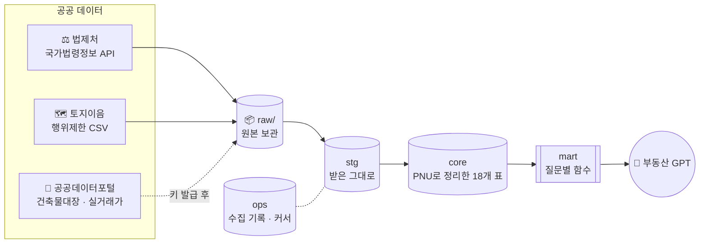

<div align="center">


# 한필지 (가칭)

**필지 하나로 잇는 부동산 공공데이터셋**<br>
땅 · 건물 · 거래 · 규제 데이터를 필지 번호(PNU)로 묶고, 부동산 전용 GPT가 읽기 좋게 정리합니다.


[데이터 흐름](#-데이터-흐름) · [빠른 시작](#-빠른-시작) · [GPT가 부르는 함수](#-gpt가-부르는-마트-함수) · [진행 상황](#-진행-상황) · [남은 일](#-남은-일)

</div>

---

## 🧭 데이터 흐름

원본은 지우지 않고 쌓고(`raw`), 받은 그대로 한 번 담았다가(`stg`), 필지 번호로 정리해(`core`), 질문별 함수로만 내보냅니다(`mart`). GPT 계정은 `mart`만 읽습니다.



| 층 | 하는 일 | 예 |
|---|---|---|
| `raw/` | 받은 파일을 날짜별로 그대로 보관 | `raw/law/2026-10-22/건축법_273437.xml` |
| `stg` | 원본 모양 그대로 한 번 담기 | `stg.law_article`, `stg.eum_rule_raw` |
| `core` | PNU · 법령 ID 기준으로 정리 | `core.doc_law`, `core.reg_rule`, `core.dim_zone` |
| `mart` | GPT가 부르는 질문별 함수 | `mart.q_law_search()` |
| `ops` | 언제 무엇을 받았는지, 어디까지 받았는지 | `ops.ingest_run`, `ops.ingest_cursor` |

## 🚀 빠른 시작

```bash
pip install -r requirements.txt
export HANPILJI_DSN=postgresql://user@localhost/hanpilji
bash scripts/init_db.sh                               # 여러 번 돌려도 됨. --postgis --pgvector 선택
python -m hanpilji.collectors.law                     # 법령 17개 → core.doc_law
python -m hanpilji.collectors.eum_rule 행위제한.csv    # 토지이음에서 내려받은 파일
```

시험:

```bash
HANPILJI_TEST_DSN=postgresql://user@localhost/hanpilji_test python -m unittest discover -s tests -t .
```

> [!NOTE]
> 법제처 수집은 공식 테스트 계정 `OC=test`로도 돌아갑니다. 운영 전에 [open.law.go.kr](https://open.law.go.kr)에서 ID를 받아 `LAW_OC` 환경변수로 넣으세요.

## 🔎 GPT가 부르는 마트 함수

| 함수 | 이런 질문에 | 최대 줄 수 |
|---|---|---|
| `mart.q_law_search(질문, 법령명?)` | 「차임 증액 청구」 「임대료 5% 상한」 | 10 |
| `mart.q_zoning_check(용도지역, 건물종류, 시군구?)` | 「이 땅에 근린생활시설 지을 수 있나?」 | 20 |
| `mart.q_building_filter(법정동 앞자리, 경과연수?, 승강기?, 위반?, 용도?, 주차?)` | 「준공 20년 넘고 승강기 없는 건물」 | 50 |

모든 함수가 `row_total`(전체 건수)을 함께 돌려줘서, GPT가 「10건만 보여드렸고 전체는 39건」처럼 말할 수 있습니다.

<details>
<summary><b>예시: 「5% 증액」 검색 결과 (실데이터, 2026-10-22)</b></summary>

```sql
SELECT article_no, law_name, row_total FROM mart.q_law_search('5% 증액') LIMIT 4;
```

| article_no | law_name | row_total |
|---|---|---|
| 제29조의2 | 도시 및 주거환경정비법 | 39 |
| 제14조의5 | 주택법 | 39 |
| 제7조 | 주택임대차보호법 | 39 |
| 제8조 | 주택임대차보호법 시행령 | 39 |

조문에는 「20분의 1」로 적혀 있어도 `search_text`에 「5%」를 덧붙여 두어서 찾힙니다.

</details>

## 📊 진행 상황

| 단계 | 내용 | 상태 |
|---|---|---|
| 0 | 규제 축: 법제처 법령 · 토지이음 행위제한 | 🟢 법령 완료 · 🟡 행위제한 CSV 대기 |
| 1 | 공공데이터포털 인증키 · 호출 확인 | ⚪ 키 대기 |
| 2 | 시세 축: 시범 구(강남구) 3년치 | ⚪ |
| 3 | GPT 엔진 연결 | ⚪ |
| 4 | 데모 | ⚪ |

**0단계 실측 (2026-10-22)**

| 항목 | 결과 |
|---|---|
| 법령 | 17개 · 조문 1,542개 · 별표 99개 (`삭제`된 조문 163개는 뺌) |
| 가장 큰 법령 | 도시 및 주거환경정비법 165조, 국토계획법 · 시행령 각 158조 |
| 시험 | 오프라인 6개(실제 응답 파일 포함) + DB 5개 통과 |

<details>
<summary><b>법령 17개 목록</b></summary>

국토의 계획 및 이용에 관한 법률 · 시행령 · 시행규칙, 건축법 · 시행령, 주택법, 주택임대차보호법 · 시행령, 상가건물 임대차보호법, 민간임대주택에 관한 특별법 · 시행령, 부동산 거래신고 등에 관한 법률, 공인중개사법, 도시 및 주거환경정비법, 부동산 가격공시에 관한 법률, 집합건물의 소유 및 관리에 관한 법률, 공동주택관리법

바꾸는 곳: [`config.toml`](config.toml) `[law] names`

</details>

## ⚙️ 정하지 않은 것의 기본값

| 항목 | 기본값 | 바꾸는 곳 |
|---|---|---|
| DB | PostgreSQL 16, DB 하나에 스키마 4개 (+ raw 폴더) | `HANPILJI_DSN` |
| 공간 · 의미 검색 | 없이도 동작 | `scripts/init_db.sh --postgis --pgvector` |
| 시범 구 | 서울 강남구 (11680) | `config.toml` `[pilot]` |
| GPT 엔진 | 미정. 마트 함수는 엔진과 무관 | — |
| 법제처 ID | 테스트 계정 `test` | `LAW_OC` |

## 📝 남은 일

- [x] 법제처 실제 응답으로 파서 확인 (2026-10-22)
- [ ] 토지이음 행위제한 CSV를 받아 `eum_rule.py`의 `COLUMN_MAP` · `ALLOWED_MAP` 채우기
- [ ] 토지이음 용도지역 이름이 `core.dim_zone`과 같은지 확인
- [ ] 공공데이터포털 인증키 발급 → `국토교통부_토지이용규제정보서비스`(행위제한 API) · 건축물대장 · 실거래가
- [ ] V-World 상업 이용 회신

## 📁 폴더

```text
hanpilji/
├── config.toml              # 정하지 않은 값은 여기만 바꾸면 됨
├── hanpilji/
│   ├── collectors/
│   │   ├── law.py           # 법제처 → core.doc_law
│   │   └── eum_rule.py      # 토지이음 CSV → core.reg_rule
│   ├── ingest.py            # 원본 보관 · 수집 기록 · 커서
│   └── textnorm.py          # 「100분의 5」 → 「5%」
├── sql/00~08_*.sql          # 스키마 · 표 · 마트 · 권한 · 기준값
├── scripts/init_db.sh
├── tests/                   # fixtures/*_real.xml 은 법제처 실제 응답
└── docs/assets/             # README 도트 그림 (make_banner.py로 다시 만듦)
```

---

<div align="center">
<sub>데이터 출처: 법제처 국가법령정보센터 · 국토교통부 토지이음 · 공공데이터포털 &nbsp;|&nbsp; 법령 본문은 저작권법 제7조에 따라 보호 대상이 아닌 저작물입니다<br>머리 그림은 이 저장소의 <code>docs/assets/make_banner.py</code>가 그린 것입니다</sub>
</div>
